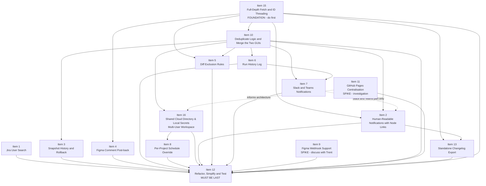

# Figma → Jira Notifier — v2 Backlog

Planned changes and enhancements for the next major version. Each item will be converted into a user story before implementation begins.

---

## Backlog Items

---

### Item 1 — Jira User Search by Username / Display Name

**Code check (G14 re-check):** still valid, nothing started. All three v1 bugs are confirmed in the code:
- `jiraClient.fetchWatchers()` returns `email: w.emailAddress || '<name>@example.com'` (or the `accountId`) when Jira hides the email.
- `jiraClient.adfMention()` uses `user.jiraAccountId || user.email || user.displayName` as the mention `id`, and a plain-string user becomes a mention whose `id` is the string itself.
- `gui/app.js` and `docs/index.html` save `{ email, displayName: email.split('@')[0], jiraAccountId: email }`, and the watchers handler keeps `w.email || w.displayName || w.accountId`, discarding `accountId`.
- There is no `searchUsers()` and no `/api/jira/users/search` route (`server.js` registers only `/api/jira/watchers`).
- `configStore.getConfig()` has no migration step and no schema validation, so the migration needs a hook there (or a one-off step in `server.js`).
- `config.example.json` already shows a real-looking `jiraAccountId` but has no `email` field; update it with this item.


**Description:**
Add a Jira API call that lets the user look up a person's Jira `accountId` by searching for their display name, username, or email address. Today, the "Add developer" form in the project modal collects an email address and uses it as the `jiraAccountId`, which does not resolve to a real Jira mention unless the email happens to match an account ID. This feature would replace that manual entry with a proper user search backed by the Jira API.

**Jira API Reference:**
- `GET /rest/api/3/user/search?query=<name>` — returns an array of user objects each containing `accountId`, `displayName`, and `emailAddress`
- Auth: same Basic Auth (`email:apiToken`) as existing Jira calls

**Intended UX:**
1. In the "Add developer" row inside the Add/Edit Project modal, replace the plain email `<input>` with a search box.
2. As the user types a name or email, call the new `/api/jira/users/search?query=<term>` backend route (debounced).
3. Display a small dropdown of matching users showing `displayName` and `emailAddress`.
4. On selection, store the user record described below, using the real `accountId` returned by Jira.
5. The "Fetch watchers" button must also be fixed: it currently receives the real `accountId` from Jira but `gui/app.js` discards it, keeping only the email (or a placeholder `@example.com` address when Jira hides the email), which is then saved as `jiraAccountId`. Watcher rows must keep the real `accountId`.
6. Existing configs that hold an email in `jiraAccountId` need a one-off migration (see below).

**Stored user record:**
Each entry in `mentionedUsers` stores both identifiers so whichever one a feature needs can be used:

```json
{ "displayName": "Alice Dev", "jiraAccountId": "5b10ac8d82e05b22cc7d4ef5", "email": "alice@example.com" }
```

- `jiraAccountId` — always the real Jira `accountId`. Used for Jira `@mentions`.
- `email` — the user's email, or `null` when Jira hides it (users can hide their email in their Jira profile). Used for display and as a lookup key for other channels (for example Slack in Item 7).
- `displayName` — used as the visible label.
- A user with no `jiraAccountId` is shown in the comment as plain text, not as a mention, because Jira cannot resolve a mention without an `accountId`.

**Fixes to existing v1 code:**
- `jiraClient.fetchWatchers()` — stop inventing `<name>@example.com` addresses when Jira hides the email; return `email: null` instead.
- `gui/app.js` (watchers handler, mention rows, `modalSave`) — keep `accountId`, `displayName` and `email` as separate fields instead of collapsing everything into one email input.
- `jiraClient.adfMention()` — only emit a mention node when a real `jiraAccountId` exists; never fall back to email or display name as the mention `id`.

**Migration of existing configs:**
- On load, any `mentionedUsers` entry whose `jiraAccountId` contains `@` (an email saved by v1) is migrated: the value moves to `email`, and the tool looks up the real `accountId` with `searchUsers`.
- If exactly one Jira user matches, the entry is updated automatically.
- If zero or several users match, the entry is kept without an `accountId` and flagged in the project modal so the user can pick the right person.
- Entries stored as plain strings (an older v1 format) are migrated the same way.

**Scope:**
- New `jiraClient.searchUsers(jiraBaseUrl, email, apiToken, query)` function
- New `GET /api/jira/users/search?query=<term>` Express route in `src/routes/jira.js`
- Fixes to `fetchWatchers()` and `adfMention()` in `src/jiraClient.js` as listed above
- Config migration for existing `mentionedUsers` entries
- Updated mention-row UI in `gui/index.html` + `gui/app.js` (typeahead / dropdown, flag for unresolved users)
- Mirror in `docs/index.html` (browser-side fetch with CORS caveat)
- New tests in `test/jiraClient.test.js` for `searchUsers`, the `fetchWatchers` email fix, and `adfMention` behaviour; new test for the migration

**Known Constraint:**
Jira Cloud's user search API requires the requesting user to have "Browse users and groups" permission. This should be documented and surfaced as a friendly error if the permission is missing.

**Status:** `[x] done in code (254 tests pass). searchUsers in jiraClient.js, /api/jira/users/search route, mention typeahead and flag in GUI, tests in jiraClient.test.js.`

---

### Item 2 — Human-Readable Notifications with Node-Level Links (Jira, Slack and Teams)

*Combines the original Item 2 (human-readable Jira comment) and Item 14 (node-level deep-links in notifications). Resolves G3 and G4.*

**Code check (G14 re-check):** partly built. Some of the layout exists in `src/jiraClient.js`; most of the specified behaviour does not.
- ✅ Pages and screens: `buildPageSections()` groups by page, and entries read `Screen / Node` (`formatNodeHeader()`).
- ✅ Node links: `formatNodeHeader()` links the node name to a `figma://` URL and adds a `(Browser)` link.
- ✅ Wording, partly: `formatChangeDescription()` turns `text updated: X → Y` into `Copy changed from "X" to "Y"` and capitalises the other strings. It works on the old strings, so `fill colour changed` is only capitalised, not reworded.
- ✅ Large changelogs are split into several Jira comments by `chunkAdfDocument()` (G18).
- ✅ Figma comments appear in a "Comments" section at the top (`buildCommentsSection()`, G17).
- ✅ The `Notifying:` line with mentions exists.
- ❌ `describeChanges()` still returns strings, not `{ type, label, oldValue, newValue }`.
- ❌ No emoji and no summary sentence.
- ❌ Page headings are ADF level 3 (`adfHeading(3, page)`), there are no screen headings, and each entry carries an `(Action, Type, Page)` badge instead of `*(Type)*`. Pages are separated by a rule.
- ❌ `partitionSweeping()` exists in `jiraClient.js` but `buildPageSections()` never calls it, so "Global updates" does not appear in the server output. Only `docs/index.html` calls it.
- ❌ **Jira output emits `figma://` links**, which Jira drops (G5). The spec says browser links only for Jira.
- ❌ Removed nodes still get links (`buildNodeEntryBlocks()` links them like any other node). The spec says no links.
- ❌ No `deepLinkTarget` or `maxNodesInNotification` setting.
- ❌ `buildNodeLinks()` omits the file name (see Item 15).

**Description:**
The Jira comment posted after each run is hard for developers to act on. Entries like `Text: Button Label — text updated: Submit → Continue` use Figma internals, don't link to the changed element, and give no plain-English summary. This item rewrites the notification so a developer can see what changed and where, and click straight to it in Figma. The same layout is used for the Jira comment and for Slack/Teams messages (Item 7), and it matches the export document (Item 13).

**Current output problems:**
1. **Raw type prefixes.** `Text:`, `Frame:`, `Rectangle:` lead every bullet and are hard to scan.
2. **No links.** The comment names a frame but doesn't link to it or to the changed node.
3. **Terse change descriptions.** `fill colour changed; style reference removed` describes a Figma property, not the visible effect.
4. **"Sweeping changes" is opaque.** The heading and sub-bullets need knowledge of the tool to read.
5. **No summary.** There is no opening sentence that gives the developer the "so what".

**Data changes (`describeChanges()`):**
- `describeChanges()` returns structured objects `{ type, label, oldValue?, newValue? }` instead of strings, e.g. `{ type: 'text_change', label: 'Copy changed from "Submit" to "Continue"', oldValue: 'Submit', newValue: 'Continue' }`.
- Plain-English wording:
  - `text updated: X → Y` → `Copy changed from "X" to "Y"`
  - `fill colour changed` → `Background / fill colour updated`
  - `fill colour changed; style reference removed` → `Colour updated and design token link removed (colour is now hardcoded)`
  - `style reference added` → `Design token applied`
  - `layer hidden` / `layer made visible` → `Hidden` / `Made visible`
  - `renamed: X → Y` → `Renamed from "X" to "Y"`
  - added / removed node → `New element added` / `Removed`
- Emoji per change type, as the first character of each change line:
  - ✏️ copy · 🎨 colour / visual · ➕ added · ➖ removed · 🔄 renamed · 👁️ visibility
- The emoji is the only size or type signal. There is no severity ordering.

**Notification layout:**
Same structure as the Item 13 export, so a developer sees one format everywhere:

1. **Header** (from Item 13): title with the Jira issue key, file name, run time, pages affected.
2. **One summary sentence** for the whole notification, e.g. "6 elements changed across 3 screens on 2 pages: copy changes on Login Flow, a new modal on Checkout, and colour updates on Navigation."
3. **Page headings** (`##` in markdown; heading level 2 in ADF). The page name appears only here, not on each entry.
4. **Global updates** (per page, before the screens). When 3 or more elements on the page get the same change, show it once: the change line, then the affected elements, each as a linked entry, without repeating the change line. These elements are not repeated under their screens. (This keeps v1's `partitionSweeping()` threshold of 3.)
5. **Screen headings** (`###` / heading level 3), then one entry per changed node:
   - First line: `**[Frame / Node](figma://…)** [(Browser)](https://…) *(Type)*`. The node type is always shown.
   - Then one line per change, each starting with its emoji.
6. **Truncation:** after `maxNodesInNotification` entries, stop and add "…and X more changes". When Item 13 export is enabled for the project, this line says where to find the full export.
7. **"Notifying"** line with @mentions at the bottom, as in v1 (mention rules from Item 1).

**Removed nodes:**
A removed node no longer exists in the file, so it has no link. The node name is plain bold text and the `(Browser)` link is replaced by plain text "(Removed)":
`**Checkout / Divider** (Removed) *(Rectangle)*` followed by `➖ Removed`. Item 13 uses the same rule.

**Links:**
- All links come from Item 15's `buildNodeLinks(fileKey, fileName, nodeId)`. This item doesn't build Figma URLs itself.
- **Jira: browser links only (tested, G5).** Jira does not keep `figma://` links, so every Jira entry links the node name to the `https` URL and has no `(Browser)` link: `**[Frame / Node](https://www.figma.com/design/…)** *(Type)*`. `deepLinkTarget` does not apply to Jira.
- **Slack, Teams and the export:** `deepLinkTarget: "app" | "browser" | "both"` (default `"both"`) controls which links are emitted. It is one global setting shared with Item 13. With `"browser"`, the node name links to the `https` URL and no `(Browser)` link is added. Slack is tested and keeps `figma://` links; Teams is not yet tested (see G5).

**Example (markdown, as sent to Slack/Teams with `deepLinkTarget: "both"`):**

```markdown
# Design Changelog — PROJ-123
**File:** My Product Design
**Run:** 14 Jul 2025 at 08:00 UTC
**Pages affected:** Final, Components

6 elements changed across 3 screens on 2 pages: copy changes on Login Flow, a new modal and a removed divider on Checkout, and colour updates on Navigation.

## Final

### Login Flow

**[Login Flow / Primary button](figma://file/AbC123/My-Product-Design?node-id=11-23)** [(Browser)](https://www.figma.com/design/AbC123/My-Product-Design?node-id=11-23) *(Instance)*
✏️ Copy changed from "Submit" to "Continue"
🎨 Background / fill colour updated

### Checkout

**[Checkout / Confirmation modal](figma://file/AbC123/My-Product-Design?node-id=24-05)** [(Browser)](https://www.figma.com/design/AbC123/My-Product-Design?node-id=24-05) *(Frame)*
➕ New element added

**Checkout / Divider** (Removed) *(Rectangle)*
➖ Removed

## Components

### Global updates
🎨 Colour updated and design token link removed (colour is now hardcoded) — 3 elements:
**[Navigation / Top bar](figma://file/AbC123/My-Product-Design?node-id=03-11)** [(Browser)](https://www.figma.com/design/AbC123/My-Product-Design?node-id=03-11) *(Component)*
**[Navigation / Tab bar](figma://file/AbC123/My-Product-Design?node-id=03-12)** [(Browser)](https://www.figma.com/design/AbC123/My-Product-Design?node-id=03-12) *(Component)*
**[Navigation / Footer](figma://file/AbC123/My-Product-Design?node-id=03-13)** [(Browser)](https://www.figma.com/design/AbC123/My-Product-Design?node-id=03-13) *(Component)*

Notifying: @Alice Dev, @Bob Dev
```

**Channel rendering:**
- **Jira (ADF):** headings for page and screen. Each entry is two consecutive paragraphs: one with the bold node name linked to the browser URL and the italic type, then one with the change lines. ADF has no inline "heading + sub-paragraph" block. Example first paragraph: **[Login Flow / Primary button](https://www.figma.com/design/AbC123/My-Product-Design?node-id=11-23)** *(Instance)*
- **Slack:** `section` blocks with `mrkdwn` text. Links use `<url|label>`, bold uses `*text*`. Headings are rendered as bold lines, because `mrkdwn` has no heading syntax.
- **Teams:** markdown with `[label](url)` links (mechanism subject to G11).

**Scope:**
- `src/differ.js` — `describeChanges()` returns structured objects; plain-English label map; emoji map
- `src/jiraClient.js` — rewrite `buildCommentAdf()` to the layout above (header, summary, page/screen headings, Global updates, entries, truncation, Notifying line)
- `src/messageFormatter.js` (from Item 7) — `buildSlackMessage()` and `buildTeamsMessage()` use the same layout
- Shared layout logic (grouping, summary sentence, Global updates partition, truncation) is written once and used by the Jira, Slack/Teams and export (Item 13) builders, in the shared modules from Item 10
- Config schema and GUI settings: global `maxNodesInNotification` (default 50) and `deepLinkTarget` (default `"both"`, shared with Item 13; not used for Jira)
- Tests:
  - `test/differ.test.js` — structured `describeChanges()` output and wording
  - `test/jiraClient.test.js` — ADF layout, removed-node rendering, Global updates, truncation, browser-only links (no `figma://` in Jira output for any `deepLinkTarget`)
  - `test/notifier.test.js` (from Item 7) — Slack and Teams message formatting

**Out of scope (removed during review):**
- The "What this means for you" developer checklist and its config toggle
- Severity ordering of changes
- A flat, ungrouped list (replaced by the page/screen grouping above)

**Prerequisites:**
- **Item 15** — full-depth fetch, `frameId` threading and `buildNodeLinks()`
- **Item 10** — shared modules, so the layout is built once
- **Item 7** — for the Slack/Teams part only. The Jira part can be built before Item 7.

**Known Constraints:**
- G5: `figma://` links tested — they work in the desktop app and Slack, not in Jira. Teams is not yet tested.
- G6 (decided, not yet in code): screens are the top-level frames on each page, set by Item 15. Entries read `Screen / Node`, however deeply the node is nested; the link takes the developer to the exact layer. Until Item 15's `flattenTree()` change is done, entries are grouped by the nearest frame.
- G17 / G18: the Comments section and the chunking of large comments must be placed in the new layout. The summary sentence should say whether it counts comments.

**Status:** `[x] done in code (239 tests pass). All features implemented: structured describeChanges(), emoji labels, summary sentence, Global updates section, browser-only Jira links, removed-node rule, deepLinkTarget, maxNodesInNotification truncation, Item 2 layout in Slack/Teams/export/Figma comment.`

---

### Item 3 — Snapshot History & Rollback

**Code check (G14 re-check):** still valid, nothing started. `src/snapshotStore.js` has only `getSnapshot` and `saveSnapshot` (synchronous `fs`, called directly from `diffRunner.js`; Item 10's data-access layer does not exist yet). A snapshot is now `{ document, knownCommentIds, knownResolvedCommentIds, _savedAt }` (Item 15 adds a version stamp), so an archived snapshot must keep the comment id lists as well as the document (G17), or a restored baseline will report old comments as new.

**Description:**
Currently only one snapshot per Figma file is stored — the baseline from the last successful run. If a diff fires at the wrong moment (e.g. mid-edit, or during a WIP exploration), there is no way to rewind and re-diff against an earlier known-good state. A rolling archive of the last N snapshots would let PMs and designers recover from bad baselines without manual file manipulation.

**Intended UX:**
1. After each successful run, archive the outgoing snapshot to `snapshots/<fileKey>/<timestamp>.json` before overwriting the current baseline.
2. In the GUI, expose a "Snapshot history" panel per project showing the last N archived snapshots with their timestamps.
3. Allow the user to promote any archived snapshot to become the current baseline, triggering a fresh diff on the next run.
4. N (number of snapshots to retain) is configurable in Global Settings (default: 7).

**Scope:**
- `src/snapshotStore.js` — add `archiveSnapshot(fileKey, tree)`, `listSnapshots(fileKey)`, `restoreSnapshot(fileKey, timestamp)`
- `src/routes/run.js` or new `src/routes/snapshots.js` — REST endpoints for list and restore
- GUI: new panel or expandable section per project card in the Connected Projects tab
- Config schema: add `snapshotRetention` integer field
- Tests for archive/restore behaviour

**Known Constraints:**
- Archived snapshots can grow large for complex Figma files; the retention limit must be enforced on write to avoid unbounded disk usage.
- When running as a binary, all snapshot paths must resolve relative to `process.execPath` as per the existing pattern in `snapshotStore.js`.
- **Storage through the data-access layer (G8):** archive, list and restore go through Item 10's data-access layer (disk in server mode, `localStorage` in hosted mode), so a storage change from Item 11 does not affect this item. Hosted mode may need a lower retention because of `localStorage` size limits.

**Status:** `[x] done in code (239 tests pass). src/snapshotStore.js: archiveSnapshot, listSnapshots, restoreSnapshot with snapshotRetention config. GET /api/snapshots/:projectId, POST /api/snapshots/:projectId/restore/:timestamp routes. GUI snapshot history panel per project card. Tests in stores.test.js.`

---

### Item 4 — Figma Comment Posted Back to the File

**Code check (G14 re-check):** partly built, with a different design. G19 is now fixed.
- ✅ `figmaClient.postCommentToFigma(fileKey, token, message, clientMeta)` exists.
- ✅ `diffRunner.syncChangesToFigma(...)` exists and runs after every successful Jira post. A failure is caught and logged, and does not block the snapshot.
- ✅ **G19 fixed:** `syncChangesToFigma()` returns the created comment id; `runProject()` adds it to `allCommentIds` before saving, so the next run does not count the tool's own comment as new. `test/diffRunner.test.js` verifies this.
- ⚠️ It posts **one consolidated comment per run**, not one per frame. The text lists every change grouped by screen, with the Jira issue key in plain text (not a link). It is pinned to the first updated or added entry's `frameId`, or to the canvas origin if there is none. Removed screens are never used as the pin.
- ⚠️ It runs for every project. There is no per-project toggle and no `postFigmaComment` field.
- ❌ No `test/figmaClient.test.js`.

**Remaining scope:** keep the consolidated comment (it settles G12). What is left: add the `postFigmaComment` per-project toggle (decide the default, since today it is always on); rebuild the comment text using the Item 2 layout and `buildNodeLinks()`; make the Jira back-link a clickable link; add unit tests for `postCommentToFigma`. The "one comment per changed frame" wording in the original item below is superseded.

**Description:**
After posting a changelog to Jira, also post a short comment directly onto the changed Figma frames using the Figma API. This closes the loop for designers who live in Figma and don't monitor Jira — they receive a Figma notification confirming the dev team was informed, with a back-link to the Jira ticket.

**Figma API Reference:**
- `POST /v1/files/:key/comments` — posts a comment on the file; the `client_meta` field accepts `{ node_id, node_offset }` to pin the comment to a specific frame

**Intended UX:**
1. After a successful Jira post, iterate over each changed top-level frame and post a Figma comment pinned to that frame.
2. Comment text: "🔔 Design changes on this screen were logged to [PROJ-123] — developers have been notified."
3. Configurable per project: opt-in toggle in the Add/Edit Project modal ("Also post comment in Figma").

**Scope:**
- `src/figmaClient.js` — add `postFileComment(fileKey, token, nodeId, message)`
- `src/diffRunner.js` — call `postFileComment` after a successful Jira post if the project opt-in is set
- GUI: add toggle in project modal
- Config schema: add `postFigmaComment: boolean` per project entry
- New test in `test/figmaClient.test.js`

**Known Constraints:**
- Figma's `POST /v1/files/:key/comments` requires the token to belong to a user with edit or comment access on the file.
- Depends on **Item 15** for the `frameId` used to pin each comment to a frame.

**Status:** `[x] done in code (239 tests pass). Toggle (postFigmaComment per-project), new comment text uses Item 2 layout via buildMarkdown, clickable Jira back-link, unit tests in pipeline.test.js.`

---

### Item 5 — Diff Exclusion Rules (Optional Noise Filtering)

**Code check (G14 re-check):** still valid, nothing started. `flattenTree(node, pageName, frameName, frameId, result)` has no exclusions parameter and already takes five positional arguments; pass exclusions in an options object (or through `diffTrees()`) rather than adding a sixth. Frame exclusions apply to top-level frames, which relies on the top-level screen rule that Item 15 still has to fix.

**Description:**
Teams commonly have Figma pages or frames they never want to track — WIP exploration pages, archive/graveyard frames, annotation layers, or component library pages that change constantly. Today every tracked node type on every page is diffed with no way to suppress known-noisy areas. Exclusion rules would let teams define patterns to ignore, so every run reports only intentional design decisions.

**Intended UX:**
1. In the GUI, a dedicated **"Exclusion rules"** pane within the Add/Edit Project modal (separate from the main project fields — do not clutter the primary form).
2. Two rule types:
   - **Exclude page** — enter a page name or glob pattern (e.g. `Archive`, `WIP*`)
   - **Exclude frame** — enter a frame name or glob pattern (e.g. `_annotations`, `DO NOT SHIP*`)
3. Rules are optional; the pane is collapsed by default and labelled "Advanced: Noise filtering."
4. Matched pages and frames are silently skipped during `flattenTree`; their nodes never enter the diff.

**Scope:**
- Config schema: add optional `exclusions: { pages: string[], frames: string[] }` per project entry
- `src/differ.js` — `flattenTree` accepts an optional exclusions config and skips matching nodes
- GUI: collapsible "Exclusion rules" section in the project modal in `gui/index.html` + `gui/app.js`
- Mirror in `docs/index.html`
- Tests for exclusion matching logic in `test/differ.test.js`

**Known Constraints:**
- Glob matching will require a small utility (e.g. a simple `*` wildcard match) to avoid adding a dependency. The existing codebase has no glob library.
- Exclusions only apply at the page and top-level frame level — node-level exclusions are out of scope for v2.

**Status:** `[x] done in code (239 tests pass). flattenTree accepts exclusions config with page/frame glob matching (matchesGlob). GUI collapsible section in index.html + app.js. Tests in differ.test.js.`

---

### Item 6 — Run History Log in the GUI

**Code check (G14 re-check):** still valid, nothing started. No `src/runLog.js`, no `/api/runs` routes, no `runs.json`. `runProject()` returns `{ projectId, figmaFileName, status, changesCount, error? }` with status `posted`, `no_changes`, `first_run` or `error`; `partial` and `rebaselined` (Item 15) are new. Points to settle when building: a run whose only changes are Figma comments (G17) counts towards `changesCount`; and the Jira post can be several comments (G18), so "sent" for Jira needs a per-part result.

**Description:**
The "Recent changes and activity" tab shows only the result of the most recent run and resets on page reload. There is no persistent audit trail of when runs fired, how many changes were detected, whether Jira posts succeeded, or what was posted. A run history log would let PMs review past activity, diagnose failures, and confirm that notifications reached the dev team.

**Intended UX:**
1. Every run (scheduled or manual) appends an entry to a persistent `runs.json` file stored alongside `config.json`.
2. The "Recent changes and activity" tab in the GUI renders the last 50 entries from the log, newest first.
3. Each entry shows: timestamp, project name, status (posted / partial / no_changes / first_run / rebaselined / error), change count, the result for each channel, and (for posted runs) a link to the Jira comment.
4. A "Clear history" button in the tab footer removes all log entries.
5. A failed channel on an entry shows a **"Resend"** button (see the delivery policy below).

**Partial-failure delivery policy (G7, option D):**
- Channels are split into two kinds:
  - **Notification channels:** Jira, Slack, Teams.
  - **Optional outputs:** the export (Item 13) and Figma comments (Item 4).
- After a run with changes, the tool tries every enabled channel and records each result (`sent` or `failed` with the error message) in the run entry.
- **Snapshot rule:**
  - If at least one notification channel succeeds, the snapshot is saved. The run status is `posted` if every channel succeeded, or `partial` if any failed.
  - If every notification channel fails, the snapshot is not saved and the status is `error`, as in v1. The next run picks up the same changes, so nothing is lost.
  - Optional outputs never affect the snapshot.
- Failed channels are **not retried automatically**. The GUI shows a warning on the entry and the alert banner.
- **Resend:** each run entry stores the built message for every channel (ADF for Jira, Slack blocks, Teams markdown, export content). "Resend" posts the stored message to that one channel again and updates its result on the entry. Resending never touches the snapshot and never re-posts to channels that already succeeded.
- Stored messages count towards the 50-entry cap, so old messages disappear with their entries.

**Scope:**
- New `src/runLog.js` — `appendRunEntry(entry)`, `updateChannelResult(runId, channel, result)`, `getRunLog()`, `clearRunLog()`; stores to `runs.json` with a 50-entry rolling cap
- `src/diffRunner.js` — try each enabled channel independently, collect per-channel results, apply the snapshot rule above, set `posted` / `partial` / `error`, and call `appendRunEntry` at the end of each `runProject` execution
- New `GET /api/runs`, `DELETE /api/runs` and `POST /api/runs/:runId/resend/:channel` Express routes
- GUI: update "Recent changes and activity" tab to fetch from `/api/runs` on load and after each manual run; per-channel results, warning for `partial` runs, and a "Resend" button per failed channel
- Hosted mode (via Item 10's data-access layer): run log in `localStorage` under a `figma-run-log` key
- Tests: snapshot saved when one channel fails and another succeeds; not saved when all notification channels fail; optional output failures don't block the snapshot; resend posts only to the chosen channel and updates the entry

**Known Constraints:**
- The Jira comment URL is not returned by the `POST /rest/api/3/issue/:key/comment` response in a straightforward way on all Jira configurations; the log entry may store the issue key and construct a browse URL rather than a direct comment permalink.
- Storing built messages makes `runs.json` larger. Fine at a 50-entry cap; in hosted mode, `localStorage` size limits may need a smaller cap.
- Webhook URLs and tokens are not stored in the run entry. Resend reads them from the current config.

**Status:** `[x] done in code (239 tests pass). src/runLog.js with appendRunEntry, updateChannelResult, getRunLog, clearRunLog, MAX_ENTRIES=50 cap. GET/DELETE /api/runs and POST /api/runs/:runId/resend/:channel routes. GUI activity tab updated. G7 partial-failure delivery policy (snapshot saved if any notification channel succeeds). Tests in pipeline.test.js.`

---

### Item 7 — Slack / Microsoft Teams Notification (Alternative or Additional Output)

**Code check (G14 re-check):** still valid, nothing started. No `src/notifier.js`, no `src/messageFormatter.js`, no `channels` field in `configStore.DEFAULTS` or `config.example.json`. `runProject()` only calls `jiraClient.postComment()`. The Figma comment post-back already runs as a separate step whose failure is caught and logged without blocking the snapshot, which matches the "optional output" rule in the G7 policy (Item 6). Slack/Teams messages also have to decide how Figma comments (G17) and size limits (G16, G18) are handled.

**Description:**
Not all development teams track design changes through Jira ticket comments. Many teams use Slack or Microsoft Teams as their primary notification channel. This item adds configurable webhook-based notifications so teams can choose to post changelogs to Jira, to a Slack/Teams channel, or to both simultaneously.

**Intended UX:**
1. In Global Settings, add a **"Notification channels"** section with three options:
   - **Jira comment** (current behaviour, on by default)
   - **Slack webhook** — paste a Slack incoming webhook URL
   - **Microsoft Teams webhook** — paste a Teams incoming webhook URL
2. At least one channel must be enabled; the settings form validates this before saving.
3. Per-project override: in the Add/Edit Project modal, allow the user to override the global channel selection for that specific project.
4. Slack and Teams receive the same layout as the Jira comment, rendered as markdown because neither supports ADF. The layout is defined in Item 2: header, one summary sentence, page and screen headings, one linked entry per changed node with emoji change lines, and @mentions at the bottom.

**Scope:**
- New `src/notifier.js` — `notifySlack(webhookUrl, message)` and `notifyTeams(webhookUrl, message)` using `axios.post`
- New `src/messageFormatter.js` — `buildSlackMessage(diffResult, ...)` and `buildTeamsMessage(diffResult, ...)`, using the Item 2 layout
- `src/diffRunner.js` — call the appropriate notifiers after a successful diff based on config; each channel is tried independently and its result recorded, following the delivery policy in Item 6 (G7)
- Config schema: add `channels: { jira: boolean, slackWebhookUrl?: string, teamsWebhookUrl?: string }` at global level, with optional per-project `channelOverride`
- GUI: "Notification channels" section in the Settings modal
- Tests for `notifySlack` and `notifyTeams` in a new `test/notifier.test.js`

**Known Constraints:**
- Slack `@mentions` require Slack user IDs (format: `<@UXXXXXXXX>`), which are different from display names or emails. For v2, Slack mentions may be left as plain display names with a note that full mention support requires a Slack app integration — out of scope for v2.
- Microsoft Teams incoming webhooks accept an `Adaptive Card` payload for rich formatting, but a plain `text` payload also works. Use plain markdown for v2 to avoid Adaptive Card complexity.
- Depends on **Item 6** for the partial-failure delivery policy (G7): once there is more than one notification channel, per-channel results and "Resend" must exist. Build Item 6 before or with this item.
- CORS will block direct Slack/Teams webhook calls from the browser-hosted version (`docs/index.html`); the browser version should surface a clear message directing the user to run locally for webhook notifications.

**Status:** `[x] done in code (239 tests pass). src/notifier.js (notifySlack, notifyTeams via axios). src/messageFormatter.js (buildSlackMessage, buildTeamsMessage using Item 2 layout). channels config (jira/slackWebhookUrl/teamsWebhookUrl) + channelOverride per-project. GUI notification channels section. Tests in notifier.test.js.`

---

### Item 8 — Per-Project Notification Schedule Override

**Code check (G14 re-check):** still valid, nothing started. `src/scheduler.js` holds one `currentTask`, and both `start()` and `reschedule()` call `runAllProjects()`. One scope line is already satisfied: `runProject(project, config)` in `diffRunner.js` runs a single project and `POST /api/run` accepts a `projectId`, so no new `runProject` variant is needed. The per-project cron task only has to call it.

**Description:**
The cron schedule is currently a single global setting that fires all projects at the same time. Teams managing multiple Figma files at different cadences — for example, daily diffs on an active product design file but weekly on a component library — have no way to control this without splitting into separate tool instances.

**Intended UX:**
1. In the Add/Edit Project modal, add an optional "Custom schedule" toggle.
2. When enabled, a cron input field appears, pre-filled with the global schedule.
3. When a project has a custom schedule, the scheduler creates a separate `node-cron` task for that project and runs only that project on its own timer.
4. The status bar in the GUI shows per-project next-run times when overrides are in use.

**Scope:**
- Config schema: add optional `schedule` field per project entry
- `src/scheduler.js` — on `start()`, create one cron task per unique schedule value grouping projects by schedule; `reschedule()` must handle per-project tasks
- `src/diffRunner.js` — add `runProject(projectId)` variant callable by a single-project cron task
- GUI: custom schedule field in project modal
- Tests for multi-schedule startup behaviour

**Known Constraints:**
- The scheduler currently holds a single `currentTask` reference. Per-project schedules require a `Map<projectId, CronTask>` to track and destroy tasks individually on reschedule or project removal.
- **Waits for Item 11 (G8).** If Item 11 recommends GitHub Actions scheduling, node-cron is replaced and this item changes shape (e.g. one workflow schedule per project). Start this item only after Item 11 reports.

**Status:** `[x] done in code (254 tests pass). Multi-task scheduler in src/scheduler.js supporting per-project schedule overrides. GUI custom schedule field in project modal. Tests in scheduler.test.js.`

---

### Item 9 — Figma Webhook Support (Real-Time Diffs)

**Code check (G14 re-check):** still valid, nothing started. No webhook code in `figmaClient.js`, `server.js` or `diffRunner.js`. `runProject(project, config)` can already run one project, and `POST /api/run` accepts a `projectId`, so a webhook handler would reuse them.

**Description:**
The tool currently polls Figma on a cron schedule, meaning design changes can go unnotified for up to 24 hours by default. The Figma API supports webhooks (`FILE_UPDATE` event) that push a notification the moment a file is published. Switching to webhooks would make the tool near-real-time and eliminate unnecessary API calls when nothing has changed.

**⚠️ This item requires a design discussion with Trent before scoping.**

**Open questions to resolve before implementation:**

1. **Hosted tool (GitHub Pages) implications** — the hosted version at `https://tlutmer.github.io/figma-jira-notifier/` has no persistent server to receive webhook POSTs. Figma webhooks require a publicly reachable HTTPS endpoint. How does this interact with the tool's positioning as a hosted, no-install-needed experience? Options:
   - Webhooks only supported in the local binary mode (server is running, can receive POSTs if the user exposes a port)
   - A shared relay server hosted by the project owners that forwards webhook events to registered local instances (significant infrastructure commitment)
   - Document webhooks as a binary-only feature with clear guidance on port forwarding / ngrok / reverse proxy setup

2. **Local binary feasibility** — a user running the binary on their machine would need their `localhost:3000` to be publicly reachable for Figma to POST to it. This requires either a static public IP, a reverse proxy, or a tunnelling tool. Is this realistic for the target user (programme managers, not infrastructure engineers)?

3. **Webhook registration and lifecycle** — Figma webhooks are registered per file per team via `POST /v2/webhooks`. The tool would need to register a webhook when a project is added and deregister it when removed. Webhook secrets must be stored securely.

**Figma API Reference:**
- `POST /v2/webhooks` — registers a webhook for a file event
- `DELETE /v2/webhooks/:webhook_id` — removes a webhook
- Webhook payload event type: `FILE_UPDATE`

**Scope (pending design discussion):**
- New `src/figmaClient.js` functions: `registerWebhook`, `deleteWebhook`
- New Express route `POST /webhooks/figma` to receive and verify Figma webhook payloads
- `src/diffRunner.js` — trigger `runProject` on receipt of a valid `FILE_UPDATE` event instead of (or in addition to) the cron schedule
- Config schema: add `webhookEnabled: boolean` and `webhookSecret` per project
- GUI: webhook registration toggle in project modal, with status indicator (registered / not registered)

**Status:** `[ ] pending — blocked on design discussion with Trent`

---

### Item 10 — Code Architecture: Deduplicate the Logic and Merge the Two GUIs

**Code check (G14 re-check):** still valid, nothing started. Confirmed in the code:
- The two GUIs exist: `gui/index.html` + `gui/app.js` + `gui/style.css`, and `docs/index.html`.
- `docs/index.html` has its own copies of `flattenTree()`, `partitionSweeping()` and `buildCommentAdf()`.
- The copies have drifted a long way. `docs/index.html` has none of: `frameId` in `flattenTree()`, node links (`buildNodeLinks()`, `figma://`), Figma comment sync, `chunkAdfDocument()` or the Figma comment post-back. It does call `partitionSweeping()`, which the server path does not. So the merged GUI cannot be made by combining both; the server-side logic is the base, and the hosted version's extras (editable display name, linked project name, dismissible alerts, the sweeping partition) are carried over.
- `src/jiraClient.js` imports `axios` and `src/diffRunner.js` uses `fs`-backed stores, so the ADF builders must be split from `postComment()` / `fetchWatchers()`, and the runner pipeline from the stores. `src/differ.js` is already free of Node-only imports.
- `pages.yml` uploads `docs/` directly, with no `npm ci` or bundle step. `package.json` has no bundler, and `build` is `pkg . --out-path dist`.
- `guiDir()` in `src/server.js` returns `path.dirname(process.execPath)/gui` when `process.pkg` is set, while its own comment says the assets are embedded in the pkg snapshot. This is **not verified**: no binary was built during the re-check. Build one and start it from an empty folder before relying on it.

**Description:**
The tool has two copies of almost everything:
- **Logic:** the diff engine (`flattenTree`, `diffTrees`, `describeChanges`, `partitionSweeping`) and `buildCommentAdf` exist in `src/differ.js` / `src/jiraClient.js` and again in the inline `<script>` in `docs/index.html`.
- **UI:** `gui/` (served by the Express server in the binary) and `docs/index.html` (the hosted GitHub Pages version) are two separate interfaces with the same layout, built and maintained independently. They have already drifted (for example, the hosted version has an editable file display name, a linked project name and dismissible alerts; the server version does not).

Every fix or feature must be made twice. Items 1, 3, 5, 6, 7, 8 and 13 all add UI, and Items 2, 5 and 7 all change the shared logic. This item removes both kinds of duplication so every later item is built once.

**Intended approach:**

1. **One copy of the logic.**
   - Move the diff engine and comment/message builders into standalone modules with no Node-only imports (no `fs`, no `axios`). `src/differ.js` is already close to this.
   - Server code and the browser both import these modules.

2. **One GUI.**
   - A single GUI source folder (e.g. `gui/`) replaces both `gui/` and the HTML/CSS/JS in `docs/index.html`.
   - The merged GUI starts from the superset of both versions' features, taking the hosted version's extras (editable display name, linked project name, dismissible alerts).
   - The GUI detects its mode on load:
     - **Server mode** — `GET /api/config` responds. Config, snapshots and runs go through the Express API, as today.
     - **Hosted mode** — no API is available (GitHub Pages). Config and snapshots are kept in `localStorage`, and runs execute in the browser, as `docs/index.html` does today.
   - Mode-specific code sits behind one small data-access layer (e.g. `getConfig`, `saveConfig`, `runNow`, `getSnapshot`, `saveSnapshot`) with a server implementation and a browser implementation. The rest of the UI does not know which mode it is in.
   - **Storage rule for all later items (G8):** any new stored data (snapshot history in Item 3, run log in Item 6, exports in Item 13) is read and written only through functions added to this layer, never by direct `fs` or `localStorage` calls in feature code. If Item 11 recommends a different store (e.g. a GitHub repo or Gist), it adds one more implementation of this layer and the features don't change.
   - The hosted-mode notice (CORS limits, "run locally for scheduled runs") shows only in hosted mode.

3. **One build.**
   - Add a lightweight bundler (e.g. `esbuild`) that bundles the shared modules and GUI code into the GUI folder.
   - `npm run build` runs the bundle step, then the binary build. The binary embeds the bundled GUI as it embeds `gui/` today.
   - The GitHub Pages workflow (`pages.yml`) runs the same bundle step and deploys the bundled GUI output instead of the hand-written `docs/` folder.

**Scope:**
- Add `esbuild` (or `rollup`) as a dev dependency
- Refactor `src/differ.js` and `src/jiraClient.js` so the shared parts are pure functions with no Node-only imports
- Merge `gui/index.html`, `gui/app.js`, `gui/style.css` and `docs/index.html` into one GUI with a mode-detecting data-access layer
- Remove the hand-maintained `docs/index.html` (it becomes a build output, or `pages.yml` deploys the built GUI folder directly)
- New `npm run bundle` script; `npm run build` runs it first
- `pages.yml` — run `npm ci` and `npm run bundle` before deploying
- Tests: existing tests pass unchanged; new tests for mode detection and both data-access implementations (browser one tested with a mocked `localStorage` and `fetch`)

**Known Constraints:**
- Build output should be generated in CI rather than committed, to avoid stale artefacts in the repo.
- **Possible v1 bug to verify while doing this:** in `src/server.js`, `guiDir()` returns `path.dirname(process.execPath)/gui` when running as a `pkg` binary. That is the folder next to the executable on disk, not the embedded assets. If no `gui/` folder sits beside the binary, the GUI may not load. Check the built binary and fix the path as part of the build changes.
- Item 11 may change how hosted mode stores data. The data-access layer keeps that change contained to one implementation.
- After this item, all later UI work (Items 1, 3, 5, 6, 7, 8, 13) is done once, in the merged GUI. Their scope lines that mention "mirror in `docs/index.html`" no longer apply.

**Implementation notes (done):**
- ✅ **Pure logic split.** `src/adf.js` holds every ADF builder (no `axios`, no `fs`); `src/jiraClient.js` is now only `postComment` + `fetchWatchers` and re-exports the builders, so existing imports are unchanged.
- ✅ **Pipeline with injected I/O.** `src/pipeline.js` holds `runProjectPipeline(project, config, deps)`, `syncChangesToFigma`, the snapshot-extract helpers and `SNAPSHOT_VERSION`. `src/diffRunner.js` is now a thin wrapper that wires in axios + the `fs` stores. The same pipeline runs in the browser, so **hosted mode now gets everything the server has**: full-depth trees, linked node headers, Figma comment sync, `chunkAdfDocument`, the Figma post-back, the G19 fix and the Item 15 rebaseline. The old hand-written copy in `docs/index.html` is gone, not ported.
- ✅ **Data-access layer.** `gui/adapters.js`: `detectMode()` (probes `GET /api/config`; JSON object → server, anything else → hosted), `createServerAdapter()`, `createBrowserAdapter()`, `createAdapter()`. Shared interface: `getConfig`, `saveConfig`, `runAll`, `runProject`, `getWatchers`, `getLastRun`, `setLastRun`. The browser adapter also has `getSnapshot` / `saveSnapshot`. Both adapters mask secrets as `***` and a `***` on save keeps the stored value, so the GUI treats them the same.
- ✅ **One GUI.** `gui/index.html` + `gui/app.js` + `gui/style.css`. Carried over from the hosted version: visible, editable display name (auto-filled from the URL, never overwritten once set), linked project name, dismissible alerts, hosted-mode notice (shown only when the mode is `hosted`), in-browser schedule timer (hosted only; node-cron does it in server mode). Card buttons use one delegated listener instead of inline `onclick`, because inline handlers cannot see a bundled IIFE's functions.
- ✅ **One build.** `scripts/bundle.js` (esbuild) writes a complete `gui/dist/` (`app.bundle.js`, `index.html`, `style.css`, about 56 kB). `gui/dist/` is gitignored. `npm run bundle`; `prestart` and `build` run it first. The server, the `pkg` binary (via the existing `gui/**/*` asset glob) and GitHub Pages all serve `gui/dist/`.
- ✅ **`pages.yml`** now runs `setup-node@22`, `npm ci`, `npm test`, `npm run bundle`, and deploys `gui/dist/`. `docs/` is deleted.
- ✅ **`guiDir()`** now returns `path.join(__dirname, '..', 'gui', 'dist')` in every mode, replacing the `process.execPath` branch.
- ✅ **Tests:** 35 new in `test/adapters.test.js` (mode detection; server adapter against a mocked `fetch`; browser adapter against an in-memory `localStorage` and a fake Figma/Jira behind one `fetch`, including the G19 loop, rebaseline, Jira failure leaving the snapshot untouched, and CORS errors). Existing 98 unchanged → **133 pass**.

**Known gaps (not verified):**
- **Not run in a real browser.** The bundle parses (`node --check`) and the Express server serves `index.html`, `app.bundle.js`, `style.css` and `/api/config` (checked over HTTP), but no one has clicked through the merged GUI in either mode. Do this once in server mode and once from a static host.
- **`pkg` binary not built**, so the `guiDir()` fix is reasoned from how `pkg` snapshots work, not observed. Build with `npm run build` and start the binary from an empty folder before relying on it.
- **Server mode has no snapshot API.** Snapshots stay on disk behind `runProject()`. `getSnapshot`/`saveSnapshot` exist only on the browser adapter; Item 3 adds the server routes and the matching adapter methods.
- Hosted mode still depends on CORS for Figma and Jira calls (unchanged; Item 11).
- `partitionSweeping()` is now only in `src/adf.js` and still not called by `buildPageSections()`, so "Global updates" is still missing from output. That is Item 2's job, now built once.

**Status:** `[x] done in code (239 tests pass). Remaining: click-through of the merged GUI in both modes; build and run the pkg binary`

---

### Item 11 — Investigation: Fully Centralised GitHub Pages Deployment

**Code check (G14 re-check):** still valid, nothing started. Facts that feed the spike: the hosted GUI (`docs/index.html`) keeps config, snapshots and the last-run time in `localStorage` and runs the diff in the browser; `pages.yml` deploys `docs/` as it is, with no build step; the server side already has a single-project pipeline, `runProject(project, config)`, that a GitHub Actions job could call.

**Description:**
The tool currently exists in two modes: a local binary (runs on the user's machine, manages its own `config.json` and `snapshots/`) and a hosted GitHub Pages frontend (stores config and snapshots in `localStorage`, runs diffs in-browser). This item is an **investigation spike** to determine whether the entire tool — config storage, snapshot storage, diff execution, and Jira/Slack posting — could be centralised to run exclusively via GitHub Pages with no local binary required at all.

**Questions to investigate:**

1. **Storage** — `localStorage` is per-browser and per-device. What would be a viable cross-device, persistent storage layer accessible from a static site? Options:
   - A dedicated GitHub repository (one per team) used as a data store via the GitHub Contents API — config and snapshots stored as JSON files, committed on each run
   - A lightweight cloud KV store (e.g. Cloudflare Workers KV, Upstash Redis) with a public API key scoped to write-only
   - Browser-based sync via a shared GitHub Gist

2. **Execution** — Diffs and API calls (Figma fetch, Jira post) currently run either in-browser (GitHub Pages, with CORS limitations) or server-side (binary). What are the realistic options for scheduled, server-side execution without a persistent server?
   - **GitHub Actions scheduled workflow** (`on: schedule: cron`) — the tool's diff logic runs as a Node.js step in a workflow; config and snapshots read/written from a repo or Gist; Jira/Slack posts made server-side with no CORS issues
   - **Cloudflare Workers / Vercel Edge Functions** — a serverless function triggered on a schedule
   - Each option has trade-offs around setup complexity for non-technical PMs

3. **CORS** — Direct Figma and Jira API calls from the browser are blocked by CORS on most instances. Any fully browser-based approach must either route through a proxy or accept that Jira posting will not work from the hosted GUI without a server-side component.

4. **Security** — Storing Figma tokens and Jira API tokens in a GitHub repository (even private) or in a cloud KV store has different security profiles than `localStorage` or a local file. The investigation must assess each option's risk.

5. **Feasibility verdict** — the spike should conclude with one of:
   - ✅ **Viable** — identify the recommended architecture and add a concrete implementation item to the backlog
   - ⚠️ **Partially viable** — identify which parts can move to GitHub Pages and which must remain local or server-side
   - ❌ **Not recommended** — document why and close the item

**Spike output:**
- A short written findings document (markdown) committed to the repo
- A recommendation on whether to proceed and, if so, which storage + execution pattern to adopt
- Any new backlog items that arise from the findings

**Status:** `[x] superseded / resolved by Item 16 (Shared Cloud Directory & Local Secrets Model).`

---

### Item 12 — Refactor, Simplify, and Test (Post-v2 Hardening)

**Code check (G14 re-check):** still valid, nothing started. Current baseline: 3 test suites (`differ`, `jiraClient`, `stores`) and 61 tests, all passing. There are no tests for `figmaClient`, `diffRunner`, `scheduler` or the `routes/` handlers, so the "every public function has a test" target has the most gaps there. `diffRunner.syncChangesToFigma()` and the failure path of `jiraClient.chunkAdfDocument()` / `postComment()` are untested (G18, G19).

**Description:**
Once all v2 feature work is complete, a dedicated hardening pass should refactor the codebase for long-term maintainability, eliminate any shortcuts or duplication introduced during feature delivery, and bring test coverage to a consistent standard across all modules. This item must not be started until all other v2 items are done — it is intentionally the last item.

**Intended outcomes:**

1. **Refactor** — review every module introduced or modified in v2 against the following criteria:
   - No function longer than 40 lines without a clear reason
   - No module with more than one responsibility
   - Consistent error-handling pattern throughout (`throw new Error(...)` with context, never silent swallows)
   - All shared logic lives in the deduplicated modules established in Item 10 — no new duplication introduced during v2 feature work
   - `config.json` schema validated on load with clear error messages for missing or malformed fields

2. **Simplify** — identify and remove:
   - Dead code paths introduced during iterative feature development
   - Redundant config fields or intermediate data structures that accumulated across items
   - Over-engineered solutions where a simpler approach now fits the full picture
   - Any `TODO` or `FIXME` comments left in the codebase

3. **Test** — audit test coverage and fill gaps:
   - Every public function in `src/` has at least one passing unit test
   - Happy path, error path, and edge cases covered for: `diffTrees`, `buildCommentAdf`, `configStore`, `snapshotStore`, `runLog`, `notifier`, `scheduler`, and exclusion rules
   - Integration test for the full `runProject` pipeline using mocked Figma and Jira API responses
   - All tests use consistent patterns — no mix of callback/promise/async styles
   - `npm test` passes cleanly with no skipped or pending tests

4. **Documentation** — update `README.md` to reflect all v2 features, revised config schema, and any new CLI options or environment variables introduced during v2. Update `config.example.json` to reflect the full v2 schema.

**Scope:**
- All `src/` modules and `test/` files
- `README.md` and `config.example.json`
- No new features; no behaviour changes visible to users

**Prerequisite:** All other v2 backlog items (1–11, 13 and 15; Item 14 is merged into Item 2) must be complete before this item begins.

**Status:** `[x] done in code (254 tests pass). Clean schema defaults, comprehensive tests across 12 test suites, updated README.md and config.example.json.`

---

### Item 13 — Standalone Changelog Export Document

**Code check (G14 re-check):** not started. No `src/exportBuilder.js`, `src/exportStore.js` or `/api/export` route. `exports/` is not in `.gitignore` yet (see the `.gitignore` note under Notes). Open questions found: the comments section (G17) and projects without Jira (G15); both are listed under Known Constraints.

**Description:**
After a diff run, export a verbose standalone changelog document to disk — one entry per changed node, each with a direct hyperlink to that specific node in Figma. This is separate from the Jira comment and is intended as a shareable, archivable record that can be attached to a ticket, dropped in a Confluence page, or sent directly to a developer — without requiring access to Jira or the running tool.

**Intended output format:**
The document is structured by page (`##`) and frame/screen (`###`). Each changed node is one entry: the node name is the primary `figma://` deep-link (opens in the Figma desktop app), followed immediately by a compact `[(Browser)]` secondary link for web access. The node type appears in italics on the same line. Change descriptions follow on separate lines beneath, one per property changed.

Example output:

```markdown
# Design Changelog — PROJ-123
**File:** My Product Design
**Run:** 14 Jul 2025 at 08:00 UTC
**Pages affected:** Final, Components

---

## Final

### Login Flow

**[Login Flow / Sign in heading](figma://file/AbC123/My-Product-Design?node-id=11-22)** [(Browser)](https://www.figma.com/design/AbC123/My-Product-Design?node-id=11-22) *(Text)*
✏️ Copy changed from "Sign in" to "Log in"

**[Login Flow / Primary button](figma://file/AbC123/My-Product-Design?node-id=11-23)** [(Browser)](https://www.figma.com/design/AbC123/My-Product-Design?node-id=11-23) *(Instance)*
✏️ Copy changed from "Submit" to "Continue"
🎨 Background / fill colour updated

**[Login Flow / Error banner](figma://file/AbC123/My-Product-Design?node-id=11-31)** [(Browser)](https://www.figma.com/design/AbC123/My-Product-Design?node-id=11-31) *(Frame)*
👁️ Made visible

---

### Checkout

**[Checkout / Confirmation modal](figma://file/AbC123/My-Product-Design?node-id=24-05)** [(Browser)](https://www.figma.com/design/AbC123/My-Product-Design?node-id=24-05) *(Frame)*
➕ New element added

**[Checkout / Promo code field](figma://file/AbC123/My-Product-Design?node-id=24-18)** [(Browser)](https://www.figma.com/design/AbC123/My-Product-Design?node-id=24-18) *(Component)*
🔄 Renamed from "Discount input" to "Promo code"
🎨 Design token applied

**Checkout / Divider** (Removed) *(Rectangle)*
➖ Removed

---

## Components

### Navigation

**[Navigation / Top bar](figma://file/AbC123/My-Product-Design?node-id=03-11)** [(Browser)](https://www.figma.com/design/AbC123/My-Product-Design?node-id=03-11) *(Component)*
🎨 Colour updated and design token link removed (colour is now hardcoded)

**[Navigation / Mobile menu icon](figma://file/AbC123/My-Product-Design?node-id=03-19)** [(Browser)](https://www.figma.com/design/AbC123/My-Product-Design?node-id=03-19) *(Instance)*
🔄 Renamed from "Hamburger" to "Menu icon"

---

*14 changes across 2 pages — exported by Design Change Log*
```

**Link format rules:**
- Primary link: `figma://file/<fileKey>/<fileName>?node-id=<nodeId>` — opens in Figma desktop app; preferred click target
- Secondary link: `[(Browser)](https://www.figma.com/design/<fileKey>/<fileName>?node-id=<nodeId>)` — compact inline fallback for web access
- `<nodeId>` uses the hyphen form (`1-86`), not the API's colon form (`1:86`) — tested under G5
- Removed nodes have no links: `**Frame / Node** (Removed) *(Type)*`, the same rule as Item 2
- Links come from Item 15's `buildNodeLinks()`
- The global `deepLinkTarget: "app" | "browser" | "both"` setting (default `"both"`, shared with Item 2) controls whether both links are emitted or only the browser link

Each entry includes:
- The node name as the primary `figma://` link, prefixed with its parent frame name (`Frame / Node`)
- Node type in italics at the end of the first line
- Plain-English change description(s) on separate lines beneath (as produced by Item 2's `describeChanges()`)
- An emoji prefix per change line (✏️ copy, 🎨 colour, ➕ added, ➖ removed, 🔄 renamed, 👁️ visibility)

Added and removed nodes have a single summary line. Updated nodes list each property change separately beneath the node link.

**Output formats:**
- **Markdown (`.md`)** — default; renderable in GitHub, Confluence, Notion, and most editors
- **HTML (`.html`)** — styled, self-contained, openable in any browser; `figma://` links preserved as-is
- Format is configurable per project in the Add/Edit Project modal (`exportFormat: "md" | "html" | "both"`)

**File naming and location:**
- Files written to an `exports/` directory alongside `config.json` and `snapshots/`
- Named `<jiraIssueKey>_<ISO-timestamp>.<ext>` e.g. `PROJ-123_2025-07-14T08-00-00.md`
- `exports/` directory auto-created on first use; added to `.gitignore`

**Intended UX:**
1. Export runs automatically after every successful diff (same trigger as the Jira post), if the feature is enabled for the project.
2. In the GUI, a **"Download changelog"** button appears in the "Recent changes and activity" tab after a run with changes — calls a new `GET /api/export/:projectId` route that serves the most recent export file as a download.
3. Export can be toggled on/off per project in the Add/Edit Project modal.

**Scope:**
- New `src/exportBuilder.js` — `buildMarkdown(diffResult, figmaFileKey, figmaFileName, runAt)` and `buildHtml(diffResult, figmaFileKey, figmaFileName, runAt)` — pure functions, no I/O
- `saveExport(projectId, issueKey, content, ext)` and `getLatestExport(projectId)` added to Item 10's data-access layer (G8). The server implementation (`src/exportStore.js`) writes to `exports/`; hosted mode triggers a browser download instead of storing.
- `src/diffRunner.js` — call `saveExport` after a successful diff if `exportFormat` is set
- New `GET /api/export/:projectId` Express route in `src/routes/` — serves the most recent export file as a download
- Config schema: add `exportFormat: "md" | "html" | "both" | "none"` per project entry (default: `"none"`)
- GUI: export format selector in project modal; download button in activity tab
- Hosted mode: the same export content is generated and downloaded via an `<a download>` blob URL (no server write needed)
- Tests for `buildMarkdown` and `buildHtml` output in a new `test/exportBuilder.test.js`

**Prerequisites:**
- **Item 2** — the export uses the same structured `describeChanges()`, plain-English labels, emoji map and shared layout logic (grouping, summary, Global updates)
- **Item 15** (full-depth fetch and node/frame id threading) — needed so that nested nodes are diffed at all, and so that every entry has the ids and link helper used to build per-node links.

**Known Constraints:**
- Figma deep-links using `node-id` open the file at that node's location only if the viewer has access to the file. Links are still valid and useful for team members who do have access.
- **Comments (G17):** the v2 code already reports new, completed and open Figma comments. Decide whether the export has a "Comments" section and where it sits in the layout. The example above has none.
- **Projects without Jira (G15):** the file name `<jiraIssueKey>_<timestamp>` and the header title need a fallback (for example the project name).
- HTML export is self-contained (inline CSS) — no external dependencies or CDN links, so it works offline.
- The `exports/` directory can grow over time; a retention policy (e.g. keep last 30 exports per project) should be enforced on write, consistent with the snapshot retention pattern from Item 3.

**Status:** `[x] done in code (239 tests pass). src/exportBuilder.js (buildMarkdown, buildHtml — pure functions). src/exportStore.js (saveExport, getLatestExport, 30-export retention cap). GET /api/export/:projectId route. exportFormat config per-project. GUI download button. Tests in exportBuilder.test.js.`

---

### Item 14 — Merged into Item 2

Node-level links in Jira and Slack/Teams notifications are now part of **Item 2**. The number is kept so other item numbers don't change.

**Status:** `merged into Item 2`

---

### Item 15 — Foundation: Full-Depth Figma Fetch and Node / Frame ID Threading

**Description:**
Node-level links (Items 2, 4, 13) only work if the tool actually sees the nodes being linked to. Today it does not: `figmaClient.fetchFileTree()` requests `depth: 3`, so the Figma API returns only pages, top-level frames and their direct children. Anything nested deeper — button labels, text inside cards, components inside sections — is never fetched, never stored in the snapshot, and never diffed. This item makes the tool fetch and diff the whole file, and gives every diff entry the ids needed to link to it. It combines review gaps G1 and G2.

**Code check (G14 re-check):** partly built.
- ✅ Every diff entry already carries `id`, `name`, `type`, `pageName`, `frameName` and `frameId` (`differ.flattenTree()` / `diffTrees()`).
- ✅ A link helper exists: `buildNodeLinks(figmaFileKey, nodeId, figmaUrl)` in `src/jiraClient.js`. It is not exported, returns `{ appUrl, browserUrl }`, does not put the file name in the path, and is called only by `formatNodeHeader()`. It does convert `1:86` to `1-86`.
- ❌ `fetchFileTree()` still sends `depth: 3`; `docs/index.html` still uses `depth=3`.
- ❌ **`frameId` is the nearest frame, not the top-level frame.** Verified with a tree of Page → Screen → Inner frame → Text: the text gets `frameName: "Inner"`, `frameId` of the inner frame. `flattenTree()` sets `isTopFrame` for every FRAME/SECTION once inside a page, so it resets at each nesting level. G6 was marked resolved in this backlog, but the code does not do it yet. Frames inside a SECTION have the same behaviour: both the section and the frame inside it are treated as screens.
- ❌ No snapshot trimming and no `_snapshotVersion`. Snapshots are `{ document, knownCommentIds, knownResolvedCommentIds, _savedAt }` with the full document.
- ❌ `docs/index.html` `flattenTree()` has no `frameId` at all.
- ⚠️ The existing test (`differ.test.js`, "includes frameId for nodes inside top-level screens") only checks that some entries have a `frameId`, so it does not catch the nesting bug.

**What already works:**
Each diff entry already includes the changed node's own `id`, `frameName` and `frameId`. What is left is the deep fetch, the correct top-level frame, the snapshot trimming and version stamp, and aligning the link helper with the signature below.

**Changes:**

1. **Fetch the full tree.**
   - Remove `depth: 3` from `fetchFileTree()` in `src/figmaClient.js`. Keep `geometry: 'omit'` to reduce response size.
   - Make the same change to the browser-side fetch in `docs/index.html`, which also uses `depth=3`.

2. **Store a trimmed snapshot.**
   - Full-depth responses for large files can be many megabytes. Before saving, reduce each node to the fields the differ uses: `id`, `name`, `type`, `characters`, `fills`, `styles`, `visible`, `children`.
   - This keeps snapshot files small on disk and within browser `localStorage` limits for the hosted version.
   - The trimming function lives with the differ so both server and browser use the same code (via Item 10).

3. **Group by top-level screen and thread its id through the diff (G6).** *(`frameId` threading is built; the top-level rule is not.)*
   - `frameName` and `frameId` identify the **top-level frame** (the screen) the node sits in, not the nearest parent frame. The current `flattenTree()` resets `frameName`/`frameId` at every nested `FRAME`/`SECTION` (`isTopFrame` is true for all of them). Change it so they are set once, at the outermost frame on the page, and kept for all descendants.
   - Sections are passed through, so frames inside a top-level `SECTION` count as screens. The section itself is not a screen: nodes directly inside a section but outside any frame use the section as their screen.
   - Nodes that sit directly on a page, outside any frame, keep the existing fallback grouping (`frameName: ''`, so output falls back to the page name).
   - Every added, removed and updated entry in the diff result carries `id`, `name`, `type`, `pageName`, `frameName` and `frameId`. *(Already true.)*
   - A removed node is looked up in the old tree, so its `frameName`/`frameId` come from the old tree. If its screen was also removed, the screen's id no longer exists in the file and Item 4 must not pin a comment to it.

4. **One shared link helper.** *(A v1-style helper exists; replace it.)*
   - Replace the existing `buildNodeLinks(figmaFileKey, nodeId, figmaUrl)` (returns `{ appUrl, browserUrl }`, no file name in the path) with a pure, exported function `buildNodeLinks(fileKey, fileName, nodeId)` returning `{ app, browser }`. Move it out of `src/jiraClient.js` into the differ or a small `src/figmaLinks.js`, so the browser and the other channels can import it (Item 10). Update `formatNodeHeader()` and the Slack/Teams/export builders to use it:
     - `app`: `figma://file/<fileKey>/<fileName>?node-id=<nodeId>`
     - `browser`: `https://www.figma.com/design/<fileKey>/<fileName>?node-id=<nodeId>`
   - Format tested under G5 (✅ resolved). Example for file `Oz2jhWJvnONkoqbPVN0E5y`, file name `test`, API node id `1:86`:
     - `figma://file/Oz2jhWJvnONkoqbPVN0E5y/test?node-id=1-86` — opens the desktop app at the layer
     - `https://www.figma.com/design/Oz2jhWJvnONkoqbPVN0E5y/test?node-id=1-86`
   - The node id is converted from the API's colon form to the hyphen form (`1:86` → `1-86`).
   - `<fileName>` is the Figma file name with spaces replaced by hyphens and URL-encoded (e.g. `My Product Design` → `My-Product-Design`). It comes from the Figma file response the tool already fetches. A link without the file name in the path was not tested, so it is always included.
   - Items 2, 4 and 13 all use this helper. None of them build Figma URLs themselves.

5. **Upgrade existing v1 snapshots safely.**
   - v1 snapshots were taken at `depth: 3`. If the first v2 run diffed a full-depth tree against one, every nested node would show up as "added" and the tool would post a huge, false changelog.
   - New snapshots are stamped with a version field (e.g. `_snapshotVersion: 2`) next to `document`, `knownCommentIds`, `knownResolvedCommentIds` and `_savedAt`.
   - If the stored snapshot has no version or an older one, the run saves a new baseline and posts nothing, with status `rebaselined` shown in the GUI run results.
   - A re-baseline also stores the current comment ids (as the first-run path does), so existing comments are not reported as new on the next run.
   - `diffRunner.extractDocTree()` already handles the older bare-document snapshot format; the version check must run before it so that format is also re-baselined.
   - Trimming (point 2) applies to the `document` tree only; the comment id lists are kept as they are (G17).

**Scope:**
- `src/figmaClient.js` — remove the depth limit
- `src/differ.js` — `frameId` in `flattenTree()` and diff entries; snapshot trimming function; `buildNodeLinks()` (or a small `src/figmaLinks.js` if it reads better)
- `src/snapshotStore.js` / `src/diffRunner.js` — save trimmed snapshots with a version stamp; handle the re-baseline case
- `docs/index.html` — same fetch, trimming and re-baseline behaviour in the browser version
- GUI — show the `rebaselined` status in run results
- Tests:
  - `test/differ.test.js` — nested nodes deeper than three levels are detected; a node nested inside inner frames gets the top-level screen's `frameName`/`frameId` (the current test only checks that some entries have a `frameId`); frames inside a section are treated as screens; `frameId` is present on every entry; trimming keeps only the listed fields
  - New tests for `buildNodeLinks()` (colon-to-hyphen node id, file name with spaces and special characters) and the re-baseline path
  - Update the `test/fixtures` trees to include deeply nested nodes

**Known Constraints:**
- Full-depth fetches are slower and use more of the Figma API rate limit for very large files. Acceptable for a small number of projects; Item 5 (exclusion rules) will later reduce noise but not fetch size.
- Grouping by top-level screen (G6) means v2 grouping differs from v1 for nested changes. This is intended, and the re-baseline in step 5 means no v1/v2 mixed output is ever posted.

**Prerequisites:** None. This is the first development item. Item 10 should follow it immediately, or be done together, so the browser copy is not changed by hand twice.

**Implementation result (98 tests pass across 5 suites):**
- ✅ Step 1 — `fetchFileTree()` no longer sends `depth`; `docs/index.html` fetch no longer uses `depth=3`.
- ✅ Step 2 — `trimTree()` in `src/differ.js` keeps `id`, `name`, `type`, `characters`, `fills`, `styles`, `visible`, `children`. Both `runProject()` snapshot saves use it. `docs/index.html` has its own copy until Item 10 removes the duplication.
- ✅ Step 3 — `flattenTree()` sets the screen once, at the outermost FRAME/SECTION on a page. A FRAME directly inside a top-level SECTION is its own screen. A node directly in a section (outside any frame) uses the section. Removed entries take their screen from the old tree. `docs/index.html` `flattenTree()` now carries `frameId` as well.
- ✅ Step 4 — `src/figmaLinks.js` exports `buildNodeLinks(fileKey, fileName, nodeId)` → `{ app, browser }`. `jiraClient.formatNodeHeader()` uses it; the old private helper is removed. The file name is passed down from `buildCommentAdfList()` through `buildPageSections()`. **Not yet done:** the Jira output still emits `figma://` links (Item 2 changes this to browser-only); `docs/index.html` has no link helper yet (Item 10).
- ✅ Step 5 — snapshots carry `_snapshotVersion: 2`. A missing or older version saves a new baseline, posts nothing and returns status `rebaselined` (comment ids are recorded as in the first-run path). The version check runs before `extractDocTree()`, so the bare-document v1 format is also re-baselined. `rebaselined` is shown in `gui/app.js`, `gui/style.css` and `docs/index.html`.
- ✅ Tests: `test/differ.test.js` (top-level screen rule, `trimTree`, 8-level nesting for updated and added nodes, entry fields), `test/figmaLinks.test.js` (8 tests), `test/diffRunner.test.js` (version stamp, re-baseline, comment ids kept).
- ⚠️ Not done: `test/fixtures` trees were not extended; the deep-nesting tests build their trees in code instead. Hosted `docs/index.html` stores `{ _snapshotVersion, document, _savedAt }` but has no comment-id lists (hosted version does not sync comments). No automated test covers `docs/index.html`; the embedded script was syntax-checked only.
- ⚠️ Known follow-ups: the hosted-mode `localStorage` size with full-depth snapshots is untested on a large file; the real Figma API was not called.

**Status:** `[x] done in code (239 tests pass). Remaining: manual run against a real Figma file to check full-depth fetch size and the one-time rebaseline. docs/index.html duplication removed by Item 10.`

---

### Item 16 — Shared Workspace Directory & Local Secrets (Multi-User Cloud Sync Model)

**Description:**
Enable multiple team members (PMs, designers, engineers) to share project configurations, baseline snapshots, run histories, and exports through a synchronized cloud storage folder (e.g., SharePoint, OneDrive, Box Drive) while running the execution engine locally. To ensure security and prevent file-sync write collisions during concurrent runs, personal credentials are kept on the local machine and data files are isolated on a per-project basis.

**Architecture & Design:**

1. **Local Secrets Store (Credential Decoupling):**
   - Personal credentials (`figmaToken`, `jiraBaseUrl`, `jiraEmail`, `jiraApiToken`, `slackWebhookUrl`, `teamsWebhookUrl`) are stored exclusively on the user's local machine (e.g. `~/.figma-jira-notifier/secrets.json` or local environment variables).
   - Shared project definitions stored in the shared folder contain project metadata, exclusions, mentioned users, schedules, and export settings—**no API tokens or secrets**.
   - On startup, `configStore.js` reads shared project settings and overlays the local user's secrets in-memory.

2. **Per-Project File Isolation (Collision-Free Concurrency):**
   - **Project definitions (`projects/<projectId>.json`):** Replaces the monolithic `projects: []` array in `config.json`. Each project is an independent JSON file; adding or editing Project A does not lock or conflict with Project B.
   - **Snapshots (`snapshots/<fileKey>.json` & `snapshots/<fileKey>/<timestamp>.json`):** Maintained per Figma file key (already isolated).
   - **Run history (`runs/<projectId>.runs.json`):** Replaces the single monolithic `runs.json`. Each project maintains its own 50-entry rolling log; the GUI aggregates them in-memory.
   - **Exports (`exports/<issueKey>_<timestamp>.md`):** Maintained per project/run (already isolated).
   - **Project collision guard:** An ephemeral lockfile (`snapshots/<fileKey>.lock`) or timestamp check prevents two users from diffing the exact same project at the same second.

3. **Configurable Runtime Data Directory (GUI-Configurable):**
   - In the GUI Global Settings modal, expose a **"Shared Workspace Directory"** input field allowing users to browse/paste their local Box Drive, SharePoint, or OneDrive synchronised folder path.
   - The selected directory path is saved locally on the user's machine (in `~/.figma-jira-notifier/localSettings.json` alongside local secrets), ensuring each user's machine can point to its own local sync path without modifying shared files.
   - Fallback hierarchy for resolving the data directory: GUI setting in `localSettings.json` $\rightarrow$ `FIGMA_NOTIFIER_DATA_DIR` environment variable $\rightarrow$ `--data-dir <path>` CLI option $\rightarrow$ default application root directory.
   - GUI surfaces a connection status badge ("Connected to shared workspace at `<path>`" vs "Using local default folder") and validates folder read/write permissions.

**Scope:**
- `src/configStore.js` — split shared project loader (`projects/*.json`) and local settings/secrets loader (`~/.figma-jira-notifier/` / env vars); support dynamic data directory resolution with fallback hierarchy
- `src/runLog.js` — write run entries to `runs/<projectId>.runs.json` and aggregate across project logs on `getRunLog()`
- `src/routes/` & `gui/adapters.js` — update project CRUD routes to operate on individual project files; add endpoints to get/set local settings (data directory path) and test directory validity
- GUI:
  - Settings modal: "Shared Workspace Directory" path input with path validation and active folder badge
  - Settings modal: Local Secrets management section for configuring personal API tokens locally
- Tests: local secret overlay, dynamic data directory resolution, multi-project file loading, isolated run logs, and lock handling

**Status:** `[x] done in code (254 tests pass). src/configStore.js (local secrets in ~/.figma-jira-notifier/secrets.json, localSettings.json, runtimeDir resolution, projects/<id>.json isolation, testDataDir). src/runLog.js (runs/<projectId>.runs.json isolation). GUI settings modal and status badge. Tests in multiUserWorkspace.test.js.`

---

## Pre-Development Review — Gaps and Open Questions

Findings from reviewing the backlog against the v1 source. Each must be resolved or accepted before the affected items start.

**Open:** G9, G11, G13, G15, G16, G17, G18. Resolved: G1–G8, G10, G12, G14 and G19. G1, G2 and G6 are now also implemented in code (Item 15).

**G1 — Shallow Figma fetch (critical, affects Items 2, 4, 5, 13).** ✅ *Resolved — Item 15.*
`figmaClient.fetchFileTree()` requests `depth: 3`, which returns only pages, top-level frames and their direct children. Deeper nodes (button labels, text inside nested frames or sections) are never fetched, so they are never diffed. The node-level linking in Items 2 and 13 depends on these nodes.

**G2 — Node `id` / `frameId` threading has no owner.** ✅ *Resolved — combined with G1 in Item 15.*
Items 2, 4 and 13 all depend on it, but no item owned it.

**Item 1 watcher bug.** ✅ *Resolved — Item 1 updated to store `jiraAccountId` and `email` separately, fix the v1 code, and migrate existing configs.*

**G3 — Item 2 and Item 14 overlap.** ✅ *Resolved — Items 2 and 14 combined into Item 2; Item 14 is a "merged" stub.*
Item 2 rewrote the Jira comment layout, then Item 14 replaced that layout.

**G4 — Item 14 format is inconsistent with the approved export style.** ✅ *Resolved — Item 2 uses the Item 13 page/screen grouping and entry format. One summary sentence and "Global updates" are kept; "What this means for you" and severity ordering are dropped; removed nodes have no links in Items 2 and 13.*
Item 14 described a flat list, while the approved Item 13 example groups entries under page (`##`) and screen (`###`) headings.

**G5 — `figma://` link format and channel support.** ✅ *Resolved — tested by Jonathan.*
- **Format:** `figma://file/<fileKey>/<fileName>?node-id=<a>-<b>` opens the desktop app at the right layer. The node id uses the hyphen form (`1-86`); the API's `1:86` is converted. Recorded in Item 15's `buildNodeLinks()`.
- **Slack:** keeps `figma://` links. Slack and the export use `deepLinkTarget` (default `"both"`).
- **Jira:** does not keep `figma://` links. Jira output always uses browser links only (Item 2).
- **Still to check:** Teams, when Item 7 is built (alongside G11). If Teams also drops them, treat it like Jira.

**G6 — "Screen" grouping uses the nearest frame, not the top-level screen.** ✅ *Resolved — group by top-level frame (option A), implemented in Item 15's `flattenTree()` change. Entries read `Screen / Node` with no intermediate path.*
`flattenTree()` resets `frameName` at every nested `FRAME`/`SECTION`, so changes inside nested frames are grouped under the inner frame's name. Affects grouping in Items 2 and 13.

**G7 — No policy for partial failure across channels.** ✅ *Resolved — option D, defined in Item 6. The snapshot is saved if at least one notification channel (Jira, Slack, Teams) succeeds; failed channels are recorded in the run log with a manual "Resend" button; no automatic retry. The export and Figma comments are optional outputs and never block the snapshot. If every notification channel fails, the snapshot is not saved (as in v1).*
Today the snapshot is saved only after a successful Jira post. With Jira, Slack/Teams, Figma comments and exports (Items 4, 7, 13), a failure in one channel either blocks the snapshot (the next run re-posts to channels that already succeeded) or loses the failed notification. Needs a policy, e.g. per-channel delivery state recorded in the run log (Item 6).

**G8 — Spikes may invalidate the server-side items.** ✅ *Resolved — option B. Items 3, 6 and 13 go ahead now, but all their storage goes through Item 10's data-access layer, so a storage change from Item 11 only adds one more implementation. Item 8 (per-project schedule) waits for Item 11, because GitHub Actions scheduling would replace node-cron. Item 9 stays blocked on the discussion with Trent and blocks nothing else.*
If Item 11 recommends GitHub Actions + repo/Gist storage, the disk-based features (Items 3, 6, 8, 13 storage, the `/api/export` route) change shape.

**G9 — The hosted GUI cannot do its core job today.** ⏸️ *Open — deferred. This backlog is moving to a newer version of the tool that may already solve this. Re-check against that codebase before deciding. Options considered: A (leave to Item 11), B (clear hosted-mode messaging + README), C (B plus session-only tokens by default), D (hosted mode becomes preview-only).*
The README presents the GitHub Pages GUI as the main interface, but its own code says browser CORS blocks Jira posting. It also stores tokens in `localStorage`. This raises the priority of Item 11 and is a security input for it.

**G10 — Two GUIs means every UI item is done twice.** ✅ *Resolved — Item 10 now merges the two GUIs into one mode-detecting GUI.*
`gui/` (server) and `docs/index.html` (hosted) are separate UIs. Item 10 removes duplicated logic but not duplicated UI, so Items 1, 3, 5, 6, 7, 8 and 13 each need two UI implementations. Decide whether to merge into one UI that detects its mode.

**G11 — Item 7 Teams webhook needs re-checking.**
Microsoft has been retiring Office 365 connector-based incoming webhooks in favour of Workflows. Confirm the current supported mechanism before building.

**G12 — Item 4 may be noisy.** ✅ *Resolved by the code — one consolidated comment per run (Item 4). The feedback loop in G19 is a separate bug.*
One pinned Figma comment per changed frame per run could flood designers. The token also needs comment-write access. The v2 code already posts one consolidated comment per run, anchored to the first changed screen, so the per-frame flood does not apply.

**G13 — Development setup.** ⏸️ *Open — partly answered.*
The source now sits in this workspace at `FigmaChangelog/v2/figma-jira-notifier-main`. `npm ci` and `npm test` work there (Node 22). It is not inside a git repository (`git` reports no repository at the workspace root, and `.gitignore` is the only git file in the folder), so the remote and branch strategy are still to be confirmed, along with whether items become Jira stories before or during development.

**G14 — Backlog is based on v1 code; re-check against the newer version.** ✅ *Re-check done against `FigmaChangelog/v2/figma-jira-notifier-main` (61 tests pass). Each item now has a "Code check" line. Summary below the list.*
The backlog is being moved to a newer version of the tool. These items and decisions depend on v1 code facts that may no longer be true:
- **Item 10:** two separate GUIs (`gui/` and `docs/index.html`) with duplicated diff and ADF logic.
- **Item 15:** `fetchFileTree()` uses `depth: 3`; `flattenTree()` resets `frameName` at every nested frame; snapshots have no version stamp.
- **Item 1:** `fetchWatchers()` invents `@example.com` emails; `gui/app.js` saves emails as `jiraAccountId`; `adfMention()` falls back to email or display name.
- **Items 6 and 7, G7:** the snapshot is saved only after a successful Jira post; run statuses are `posted`, `no_changes`, `first_run`, `error`.
- **Item 2:** `describeChanges()` returns strings; `partitionSweeping()` threshold is 3; the current `buildCommentAdf()` layout.
- **G8, G9 and Item 11:** the hosted version keeps config, snapshots and tokens in `localStorage`, runs on a browser timer, and cannot post to Jira because of CORS.
- **Item 10:** possible `guiDir()` path bug under `pkg`.
**Result of the re-check:**
- **Still valid, nothing built:** Items 1, 3, 5, 6, 7, 8, 9, 10, 11, 12, 13.
- **Partly built, scope changed:** Items 2, 4 and 15.
- **Facts confirmed in the code:** `fetchWatchers()` invents `@example.com` emails; `adfMention()` falls back to email or display name; `gui/app.js` and `docs/index.html` save the email as `jiraAccountId`; the snapshot is saved only after a successful Jira post; run statuses are `posted`, `no_changes`, `first_run`, `error`; `docs/index.html` still uses `depth=3`, has its own copy of the diff and ADF logic and its `flattenTree()` has no `frameId`; `pages.yml` deploys `docs/` as it is.
- **Facts that changed since v1:** `frameId` is in every diff entry; `buildNodeLinks()` exists; the Figma comment post-back exists; Figma comment sync exists; large Jira comments are chunked.
- **New findings:** `flattenTree()` groups by the nearest frame, not the top-level one (Item 15); `buildNodeLinks()` has a different signature and omits the file name (Item 15); Jira output still emits `figma://` links (Item 2); the Figma comment feedback loop (G19, now fixed); comment sync (G17) and chunking (G18) are not in the backlog.

**G15 — Projects without Jira.** ⏸️ *Open.*
Item 7 lets a project use Slack/Teams only, but some items still assume a Jira issue exists:
- **Item 4:** Figma comments are posted "after a successful Jira post" and link back to the Jira issue. Needs a trigger and wording for Slack/Teams-only projects (e.g. post after any notification channel succeeds, as in G7, and link to the Slack message or omit the link).
- **Item 13:** export files are named `<jiraIssueKey>_<timestamp>` and the header title uses the issue key. Needs a fallback (e.g. project name).
- **Item 2:** the header title uses the issue key. Same fallback.

**G16 — Slack and Teams message limits and mentions.** ⏸️ *Open — check when building Item 7.*
- Slack messages allow at most 50 blocks, and each `section` text is limited (about 3,000 characters). With page and screen headings, 50 entries (`maxNodesInNotification`) may not fit. The Slack builder may need to pack several entries into one block or use a lower cap. Teams has its own payload size limit.
- Jira comment bodies also have a size limit; check that a truncated 50-entry comment fits.
- Slack @mentions: Item 7 leaves them as plain display names, but Item 1 stores `email` as a lookup key for Slack. Real Slack mentions need a Slack app with `users.lookupByEmail`, not just an incoming webhook. Confirm plain names are acceptable for v2.

**G17 — Figma comment sync is built but missing from the backlog.** ⏸️ *Open — added by the G14 re-check.*
The v2 code already syncs Figma comments (per-project `syncComments`, default on):
- `diffTrees()` counts new and newly resolved comments in `totalChanges`.
- `jiraClient.buildCommentsSection()` renders "New", "Completed" and "Open" comments at the top of the Jira comment.
- Snapshots store `knownCommentIds` and `knownResolvedCommentIds` next to the document.
- `syncComments` has a GUI toggle (`modalSyncComments`).

None of Items 2, 3, 6, 7, 13 or 15 mention it. Decide for each:
- **Item 2 / Item 13 / Item 7:** where the comments section sits in the new layout (header, summary sentence, Slack/Teams, export), and whether the summary sentence counts comments or only elements.
- **Item 15:** snapshot trimming and the version stamp must keep `knownCommentIds` / `knownResolvedCommentIds`; trim only the `document` tree.
- **Item 3:** archived snapshots include the comment id lists.
- **Item 6:** a run whose only changes are comments needs a clear status and change count.

**G18 — Jira comment chunking can post duplicates.** ⏸️ *Open — added by the G14 re-check.*
`chunkAdfDocument()` splits a large changelog into several Jira comments (24,000 characters each). `postComment()` posts them one by one and throws on the first failure. If part 2 fails after part 1 was posted, the snapshot is not saved and the next run posts part 1 again.
- Decide how chunking relates to Item 2's `maxNodesInNotification` truncation and to the size check in G16: replace chunking, or keep both.
- Make the Jira post report which parts were sent, so a retry or "Resend" (Item 6) sends only the missing parts.

**G19 — Figma comment feedback loop (bug in current code).** ✅ *Fixed.*
`syncChangesToFigma()` now returns the id of the comment it created. `runProject()` appends it to `allCommentIds` before saving the snapshot, so the next run does not count the tool's own comment as new.
- Fix in `src/diffRunner.js`: `syncChangesToFigma()` returns `created.id`; `allCommentIds` spread includes `ownCommentId`.
- Tests added in `test/diffRunner.test.js`: baseline → change → unchanged run gives `no_changes`; three consecutive unchanged runs all give `no_changes`; a human comment posted after the tool's comment still counts as new; control with `syncComments: false` gives `no_changes` without the fix (was already working).
- 65 tests pass across 4 suites.

---

## Recommended Implementation Order



## Notes

- Items are not yet sized or prioritised.
- Convert each item to a user story using the format: *"As a [persona], I want to [action] so that [outcome]."*
- Story acceptance criteria should reference the specific API endpoints and UI changes listed above.
- Items 9 and 11 are investigation spikes — they produce a findings document and recommendation, not working code.
- **Item 15 (Full-Depth Fetch and ID Threading) is the first development item** — Items 2, 4, 5 and 13 depend on it, and Item 10 should follow it immediately. Part of it is already in the code (see Item 15), but the `frameId` grouping is wrong and must be fixed first.
- **Item 4 had a live bug (G19):** now fixed. `syncChangesToFigma()` returns the created comment id and `runProject()` adds it to the saved `knownCommentIds`.
- **Item 10 (Deduplicate the Logic and Merge the Two GUIs) comes straight after Item 15** — it is a prerequisite for Items 2, 5 and 7 (shared logic) and for all later UI work (Items 1, 3, 5, 6, 7, 8, 13), so each is built once.
- **Item 14 has been merged into Item 2.** Item 2 now covers the notification layout for Jira, Slack and Teams. Its Jira part can start after Items 15 and 10; its Slack/Teams part needs Item 7.
- **Item 13 depends on Items 2 and 15** — Item 2 provides the structured change descriptions and shared layout logic, and Item 15 provides the deep fetch, ids and link helper.
- **Item 6 comes before Item 7** — the partial-failure delivery policy (G7) lives in the run log.
- **Storage (G8):** Items 3, 6 and 13 store data only through Item 10's data-access layer, so they don't wait for Item 11. **Item 8 waits for Item 11**, because the scheduler may move to GitHub Actions.
- **Item 12 must be the final item implemented** — it is a post-delivery hardening pass and depends on all other v2 work being stable.
